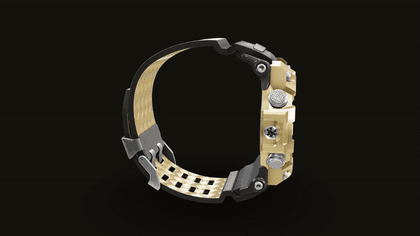
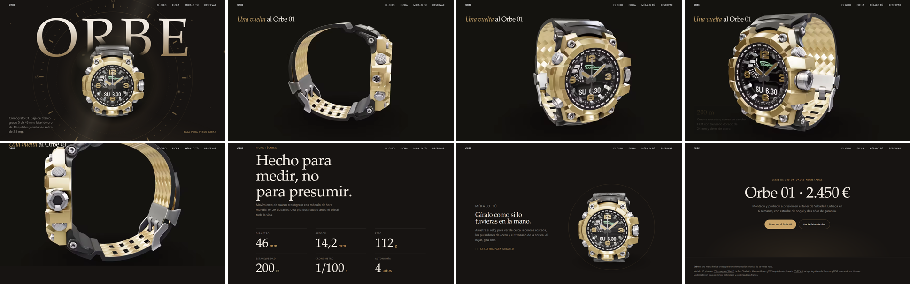
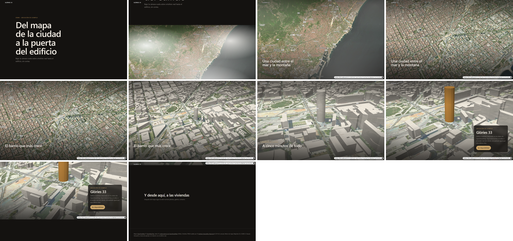
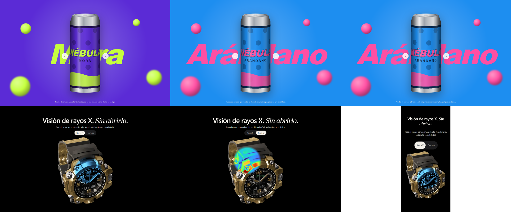

# webs-premium · Claude Code marketplace

**v1.0.0-beta.3** · [Leer en español](README.es.md)

Claude Code skills for building **premium, "impossible-looking" websites**: cinematic scroll driven by video frames, the product told from the inside with realistic AI imagery, depth layers with real shadows, real 3D (glTF), a can that spins without 3D, an X-ray lens under the cursor, AI product photos from real photos, and a real map that flies down to a building.

The skills are organised **by techniques that combine**, not by visual styles. A master skill (**WEB PREMIUM**) takes your brief, picks the "star moment", chooses and combines techniques, plans the assets with their cost, builds the site and verifies it with screenshots.

<p align="center"></p>

> The skills are written in **Spanish** (their trigger descriptions are in Spanish and English). Claude reads them fine whatever language you write in.

## Install
Requirements:
- A recent Claude Code with `/plugin`.
- For the scripts: **Node 20+** and **ffmpeg** in the PATH (or its path in the `FFMPEG` / `FFPROBE` environment variables).
- For the generated websites: npm. Visual verification uses Chrome/Chromium through `playwright-core`.

In Claude Code:
```
/plugin marketplace add FefeRP/webs-premium
/plugin install web-premium@webs-premium
```
Restart Claude Code (or `/reload-plugins`) and check with `/plugin` that `web-premium` is enabled.

From the terminal it works the same way:
```
claude plugin marketplace add FefeRP/webs-premium
claude plugin install web-premium@webs-premium
```

- **Update:** `/plugin marketplace update webs-premium`.
- **Try it without installing:** `git clone https://github.com/FefeRP/webs-premium.git` and `claude --plugin-dir webs-premium/plugins/web-premium`.

## Use
Start your request with the keyword **`WEB PREMIUM:`** (or run `/web-premium …`) and describe the business, the product and the assets you have:

```
WEB PREMIUM: landing page for a limited-edition watch; I have 4 product photos and the logo; I want it to turn as you scroll
```

The master skill then:
1. Writes the brief and picks the star moment.
2. Chooses the techniques (from the skills below) and how they combine.
3. Plans the assets, with an estimated cost.
4. Builds the site from its template (Vite + GSAP + Lenis).
5. Verifies it with screenshots on desktop, mobile and reduced motion.

> **No spending without asking.** The skills never use paid services (Higgsfield, image or video APIs) without first giving you an estimated price and waiting for your yes. Everything in this repo was made with free tools or code.

## Skills
| Skill | What it does |
|---|---|
| `web-premium` | Master skill (keyword **WEB PREMIUM**): directs the whole process; Vite + GSAP + Lenis template; `nueva-web.mjs` (scaffold) and `verificar-scroll.mjs` (screenshots at each scroll step) |
| `scroll-frames` | Video → WebP/AVIF frames (desktop and mobile) → canvas tied to the scroll (Apple-style scrubbing); video mode alternative; data HUD tied to progress |
| `video-ia-para-scroll` | How to ask Higgsfield, Kling, Veo, Luma… for a video made for scrolling (camera, background, loop, consistency, prompts) and review it automatically; "product from the inside" recipe in chained segments with a budget |
| `fotos-producto-ia` | AI product photos that keep the real product: reference photos, prompts per shot and light, consistency, layers, detecting and fixing deformations, prices |
| `parallax-capas` | 2.5D depth: layers moving with scroll and pointer, CSS scroll-driven; `capas-sombra.mjs` extracts the shadow as its own semi-transparent layer (floating product, background swap) |
| `escena-3d-gltf` | three.js with an optimised glTF (meshopt), PBR environment, drag and scroll, mobile performance, cancellable loading |
| `lente-revelado` | A lens that follows the cursor (or finger) and reveals an aligned version of the image: X-ray, thermal, interior; mode switch; before/after curtain on scroll; `variantes-revelado.mjs` makes X-ray and thermal versions with ffmpeg and checks alignment |
| `envase-giratorio` | A can, jar or bottle that spins without 3D: the flat label is wrapped onto a cylinder in a 2D canvas with shading and lid; spin on scroll, drag or a flavour slider (background, title and fruit change together) |
| `mapa-zoom-ubicacion` | From the map to the building: MapLibre with real orthophoto (PNOA in Spain, free) and OSM 3D buildings; camera stops tied to the scroll, highlighted building; map sources with licences and prices |

## Screenshots
Demo site built with the master skill (`demos/reloj`, fictional brand "Orbe"):


From the map to the building (`demos/mapa`, example location in Barcelona; map data © OpenStreetMap contributors, orthophoto PNOA © IGN):


Spinning can with flavour slider, and the X-ray / thermal lens (`pruebas/lente-envase`, invented brand "Nébula"):


## What's in the repo
- `.claude-plugin/marketplace.json` → `plugins/web-premium/` (the plugin: `plugin.json`, `commands/`, `skills/`).
- `demos/reloj/`: demo website made with the master skill. `cd demos/reloj && npm install && npm run dev` → http://127.0.0.1:5190.
- `demos/mapa/`: from the map to the building. `cd demos/mapa && npm install && npm run dev` (needs internet: tiles load live).
- `pruebas/`: checks of the scripts against known results; `pruebas/lente-envase/` is a no-build test page (serve the repo root with any static server).
- `docs/referencias/`: written analyses of 11 reference websites and videos. The videos themselves are not included: they belong to their authors.
- `docs/investigacion/`: notes on the ecosystem, marketplaces and AI video.
- `capturas/`: verification contact sheets.

## Beta status
**Tested:** strict validation of the marketplace and plugin; install from scratch; both demos verified with no errors on desktop, mobile and reduced motion (Chrome, software WebGL); `capas-sombra` measured against a rendered ground truth; engines tested in Chrome (load cancellation, frame retry, can, lens and curtain with an interaction test).

**Not tested yet:** real generation with Higgsfield (paid); rembg, IC-Light and local editing models (need Python or a GPU); paid map sources (MapTiler, Esri).

Changes: [CHANGELOG.md](CHANGELOG.md) (in Spanish).

## Licence and credits
Code and texts: [MIT](LICENSE). Third-party material keeps its own licence — the Chronograph Watch model used in the demo (CC-BY 4.0, Khronos Group / Eric Chadwick), map data (OSM/ODbL, OpenFreeMap, IGN PNOA CC-BY 4.0) and ideas adapted from `nateherkai/scroll-craft` (MIT): see [CREDITOS.md](CREDITOS.md).
